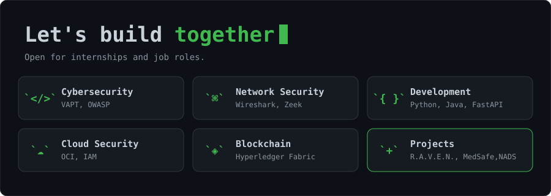



<h3><code>nandanverse@github ~ $ ./contributions.sh</code></h3>

  

<h3><code>nandanverse@github ~ $ whoami</code></h3>
<table>
  <tr>
    <td valign="top"></td>
    <td valign="top"></td>
  </tr>
</table>

  

<h3><code>nandanverse@github ~ $ ./stats.sh</code></h3>

  

<h3><code>nandanverse@github ~ $ ./id.sh</code></h3>

  

<h3><code>nandanverse@github ~ $ ./traits.sh</code></h3>

  

<h3><code>nandanverse@github ~ $ ./build.sh</code></h3>

  

<h3><code>nandanverse@github ~ $ ./links.sh</code></h3>

**Cybersecurity Developer | Student | Security Research**

[GitHub](https://github.com/Nandanverse) | [LinkedIn](https://www.linkedin.com/in/nandanamin) | [Instagram](https://www.instagram.com/nandanverse)

